<!-- ===================== HERO BANNER & NEURAL SPHERE ===================== -->

 

  
  
  
  
  

<!-- ===================== PILARES DE ENGENHARIA (2x2 GRID) ===================== -->
<h2>⚡ Arquitetura &amp; Pilares de Atuação</h2>

 

<!-- ===================== PROJETOS EM DESTAQUE (FULL-WIDTH RESPONSIVE CARDS) ===================== -->
<h2>🚀 Projetos &amp; Arquiteturas em Destaque</h2>
Clique em qualquer card para abrir o repositório ou o portfólio completo

  

  

  

  

  

<!-- ===================== STACK TECNOLÓGICA ===================== -->
<h2>🛠️ Ecossistema &amp; Stack Tecnológica</h2>

<table>
  <tr>
    <th>Área</th>
    <th>Tecnologias</th>
  </tr>
  <tr>
    <td><strong>🤖 Engenharia de IA &amp; Agentes</strong></td>
    <td>
      
      
      
      
      
      
    </td>
  </tr>
  <tr>
    <td><strong>⚙️ Back-End &amp; Corporativo</strong></td>
    <td>
      
      
      
      
      
    </td>
  </tr>
  <tr>
    <td><strong>🎨 Front-End &amp; Mobile</strong></td>
    <td>
      
      
      
      
      
      
    </td>
  </tr>
  <tr>
    <td><strong>🗄️ Bancos de Dados &amp; Cache</strong></td>
    <td>
      
      
      
      
      
      
    </td>
  </tr>
  <tr>
    <td><strong>☁️ Cloud, DevOps &amp; Infra</strong></td>
    <td>
      
      
      
      
    </td>
  </tr>
</table>

 

  

<!-- ===================== ANALYTICS ===================== -->
<h2>📊 GitHub Analytics</h2>

  
  

 

<!-- ===================== FOOTER ===================== -->

